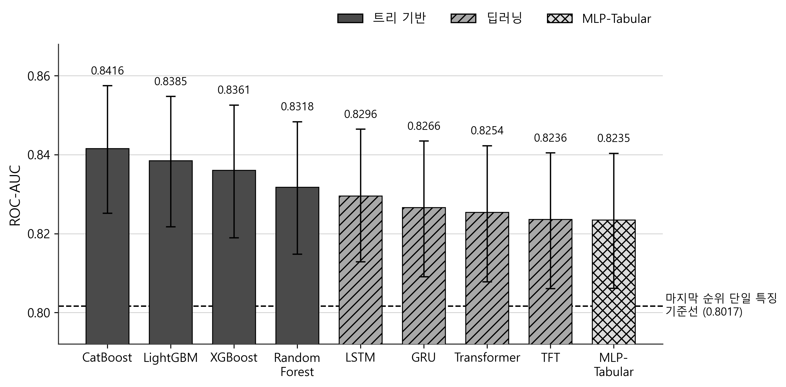
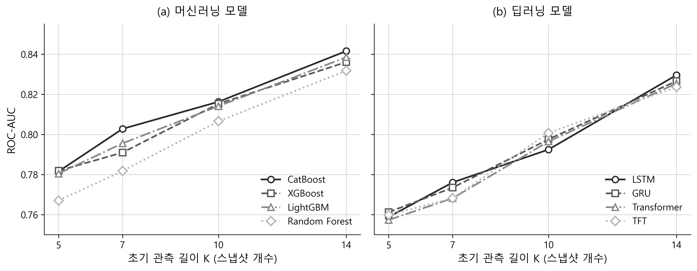

# Early Prediction of YouTube Trending Persistence from Initial Snapshots

[한국어](README.md) | **English**

Predicting which videos will **remain in the trending list for longer**, using only their first K trending snapshots. This repository accompanies a KCI-indexed journal paper and compares tree-based models with sequence models using early observations and derived features.

[Paper](https://www.kci.go.kr/kciportal/ci/sereArticleSearch/ciSereArtiView.kci?sereArticleSearchBean.artiId=ART003397844) · [Results](#results) · [Key code](#key-code) · [Data and environment](docs/DATA_AND_ENVIRONMENT.md) · [Citation](#citation)

## Publication

### Early Prediction of YouTube Trending Persistence from Initial Snapshots

**이훈제**, 박영아, 박준, 정세훈, 심춘보 
*Smart Media Journal*, **15(10), 172–184**, October 2026

The official abstract confirms the dataset size and CatBoost (K=14) results: **ROC-AUC 0.8416 · AP 0.6294 · F1 0.6270**, matching the archived v3 aggregates. Author names follow the KCI record. [Official KCI record](https://www.kci.go.kr/kciportal/ci/sereArticleSearch/ciSereArtiView.kci?sereArticleSearchBean.artiId=ART003397844) · [Paper and code notes](docs/PAPER.md) (Korean)

| Study population | Early observation length | CatBoost ROC-AUC |
|:---:|:---:|:---:|
| **17,883 Korean trending videos** | **K = 5 · 7 · 10 · 14** | **0.8416** |

## Research Task

- **Input:** the first K trending snapshots of a video, static features, and change-related features.
- **Target:** whether the video appears in **at least 60 distinct trending snapshots** overall.
- **Label definition:** 60 is the 75th percentile of the full video population's snapshot counts; **4,575 videos** are positive.
- **Models:** Random Forest, XGBoost, LightGBM, CatBoost, MLP, LSTM, GRU, Transformer, and a TFT-style model.

The task is conditional on a video already appearing in the trending data. It does not predict trending entry or general popularity across all YouTube videos. The K=14 experiment includes **17,410 eligible videos**, with a **70/15/15** training, validation, and test split in the main experiments.

## Results

These are the archived **v3 test results for K=14**. F1 uses a threshold selected on the validation set and applied to the test set.

| Model | ROC-AUC | AP | F1 |
|:---|---:|---:|---:|
| **CatBoost** | **0.8416** | 0.6294 | 0.6270 |
| LightGBM | 0.8385 | **0.6353** | 0.6272 |
| XGBoost | 0.8361 | 0.6286 | **0.6284** |
| Random Forest | 0.8318 | 0.6150 | 0.6226 |
| LSTM | 0.8296 | 0.5940 | 0.6236 |
| GRU | 0.8266 | 0.5853 | 0.6261 |
| Transformer | 0.8254 | 0.5769 | 0.6198 |
| TFT | 0.8236 | 0.5838 | 0.6219 |
| MLP-Tabular | 0.8235 | 0.5758 | 0.6215 |

CatBoost's saved 95% bootstrap confidence interval for ROC-AUC is **[0.8252, 0.8575]**. LightGBM has the highest AP and XGBoost the highest F1. [ML results](results/tables/tab6_ml_v3.csv) · [DL results](results/tables/tab6_dl_v3.csv)

Performance across early observation lengths

Eligible video populations differ across K. This comparison does not isolate observation length on an identical cohort. [ML aggregates](results/tables/tab7_ml_kabl_v3.csv) · [DL aggregates](results/tables/tab8_dl_kabl_v3.csv)

The reported values match the archived CSV files. Training and evaluation were not rerun for this release. Differences from earlier manuscript values, cohort definitions, and limitations of additional experiments are documented in the [result notes](docs/RESULTS.md) (Korean).

## Key Code

| Purpose | File |
|:---|:---|
| Preprocess raw CSVs and construct labels | [2_preprocess.py](2_preprocess.py) |
| Build early-observation sequences and splits | [4_make_sequence.py](4_make_sequence.py) |
| Machine learning and deep learning experiments | [3_run_ml_v2.py](3_run_ml_v2.py) · [5_run_dl.py](5_run_dl.py) |
| v3 machine learning tables and evaluation | [ml_tables_v3.py](ml_tables_v3.py) · [eval_v3_main.py](eval_v3_main.py) |
| Deep learning evaluation | [eval_dl_v3.py](eval_dl_v3.py) |
| Plot saved v3 metrics | [9_paper_figures_v3.py](9_paper_figures_v3.py) |

The code contains several historical experiment branches. Running every numbered file in order is not a single final reproduction pipeline. See the [code map](docs/CODE_MAP.md) (Korean) for branch roles and portability changes made to public copies.

Technologies: **Python · pandas · scikit-learn · PyTorch · XGBoost · LightGBM · CatBoost · Matplotlib**

## Layout and Usage

~~~text
*.py                  Research preprocessing, training, evaluation, and plotting
requirements.txt      Direct research dependencies
results/tables/       Aggregate results without per-video identifiers
results/figures/      Selected result plots
docs/                 Environment, code, and result provenance notes
~~~

Run scripts from the repository root after preparing the required data, processed arrays, and model files. This is a research code archive; the [data and environment guide](docs/DATA_AND_ENVIRONMENT.md) includes setup notes and an English summary.

Raw data, per-video predictions, model weights, manuscripts, and review correspondence remain in the local research archive. Installation metadata from the original environments is retained; create a fresh environment to run experiments. The public package contains code, documentation, and selected aggregate results.

## Citation

> 이훈제, 박영아, 박준, 정세훈, 심춘보. (2026). Early Prediction of YouTube Trending Persistence from Initial Snapshots. *Smart Media Journal*, 15(10), 172–184.

[BibTeX](CITATION.bib) · [CITATION.cff](CITATION.cff) · [KCI record](https://www.kci.go.kr/kciportal/ci/sereArticleSearch/ciSereArtiView.kci?sereArticleSearchBean.artiId=ART003397844)
