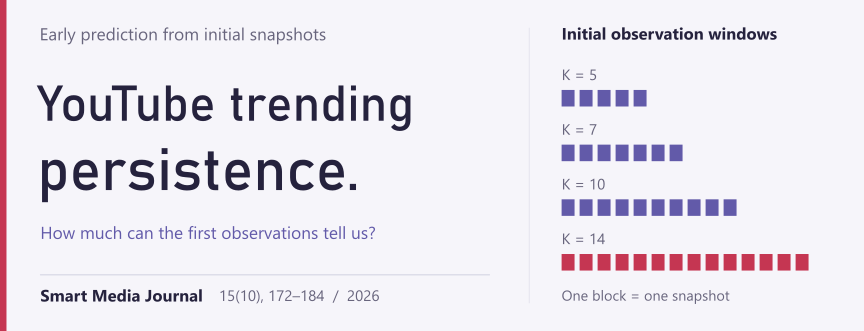
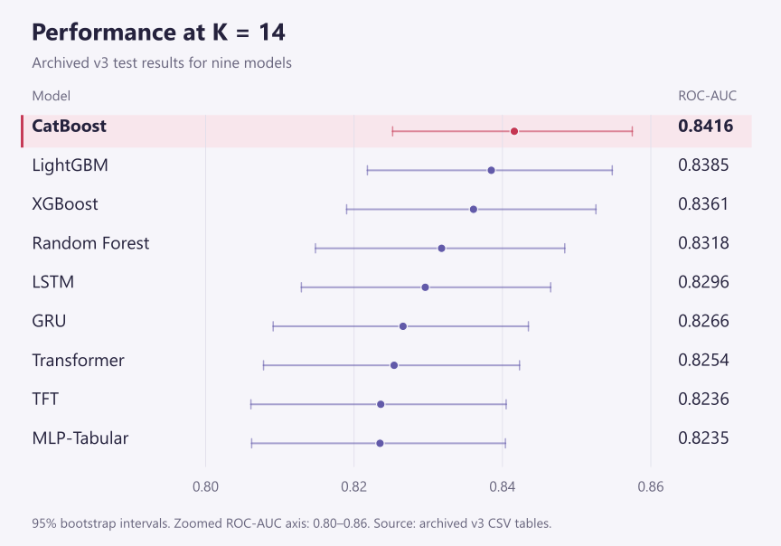
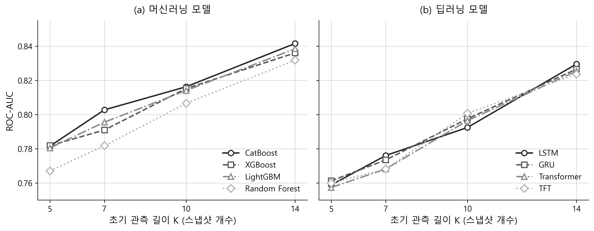

[English](README.md) · **한국어**



어떤 영상이 트렌딩 목록에 오래 머무를까요? 영상의 **초기 K개 트렌딩 스냅샷**으로 장기 지속 여부를 예측하고, 한국 YouTube 트렌딩 데이터에서 트리 기반 모델과 시계열 모델을 비교한 연구입니다.

**[논문 정보](https://www.kci.go.kr/kciportal/ci/sereArticleSearch/ciSereArtiView.kci?sereArticleSearchBean.artiId=ART003397844)** &nbsp; · &nbsp; **[연구 결과](#연구-결과)** &nbsp; · &nbsp; **[코드 살펴보기](#주요-코드)**

## 예측 과제

**한국 트렌딩 영상 17,883개** · **관측치 872,060개** · **K = 5, 7, 10, 14**

- **관측:** 초기 K개 트렌딩 스냅샷과 정적·변화량 특징
- **예측:** 전체 트렌딩 등장 횟수가 **60회 이상**인 장기 지속 영상 여부
- **비교:** Random Forest와 CatBoost부터 LSTM, GRU, Transformer, TFT 계열까지 아홉 가지 모델

이미 트렌딩에 등장한 영상을 대상으로 목록 내 지속성을 예측합니다. 전체 등장 횟수에는 초기 K개 관측도 포함됩니다. 기준인 60회는 전체 영상 분포의 75백분위수이며, **양성 영상은 4,575개**입니다.

## 연구 결과

주 실험의 **K=14** 조건은 관측 요건을 만족한 **17,410개 영상**을 사용하며, 학습·검증·시험 데이터를 **70/15/15로 층화 무작위 분할**합니다.



**ROC-AUC 점추정치는 CatBoost가 0.8416으로 가장 높습니다.** **AP는 LightGBM(0.6353)**, **F1은 XGBoost(0.6284)**가 가장 높습니다. F1은 검증 데이터에서 선택한 임곗값을 시험 데이터에 적용한 값입니다.

그래프는 보관된 [ML](results/tables/tab6_ml_v3.csv)·[DL](results/tables/tab6_dl_v3.csv) 집계 CSV에서 직접 생성했습니다. 신뢰구간은 불확실성을 나타내며, 점추정치 순위만으로 모델 간 유의한 차이를 확정하지 않습니다.

<details>
<summary>전체 성능 표</summary>

| 모델 | ROC-AUC | AP | F1 |
|:---|---:|---:|---:|
| **CatBoost** | **0.8416** | 0.6294 | 0.6270 |
| LightGBM | 0.8385 | **0.6353** | 0.6272 |
| XGBoost | 0.8361 | 0.6286 | **0.6284** |
| Random Forest | 0.8318 | 0.6150 | 0.6226 |
| LSTM | 0.8296 | 0.5940 | 0.6236 |
| GRU | 0.8266 | 0.5853 | 0.6261 |
| Transformer | 0.8254 | 0.5769 | 0.6198 |
| TFT | 0.8236 | 0.5838 | 0.6219 |
| MLP-Tabular | 0.8235 | 0.5758 | 0.6215 |

CatBoost의 저장된 ROC-AUC 95% bootstrap 신뢰구간은 **[0.8252, 0.8575]**입니다. CSV에는 아홉 모델의 신뢰구간이 모두 포함되어 있습니다. [보관된 원본 비교 그림](results/figures/fig1_model_comparison.png)

</details>

<details>
<summary>초기 관측 길이에 따른 비교</summary>



K=5 / 7 / 10 / 14의 대상 영상 수는 각각 **17,743 / 17,677 / 17,569 / 17,410개**입니다. 표본이 달라, 동일한 영상 집합에서 관측 길이의 효과만 분리한 비교로 해석하지 않습니다.

[ML 집계](results/tables/tab7_ml_kabl_v3.csv) · [DL 집계](results/tables/tab8_dl_kabl_v3.csv)

</details>

이번 공개 과정에서 학습·평가를 다시 실행하지 않았습니다. KCI 초록에서 데이터 규모와 CatBoost 대표 수치를 확인했으며, 전체 모델 비교를 발행 논문 본문과 대조한 것은 아닙니다. [결과 출처와 해석 범위](docs/RESULTS.md)

## 논문 소개

**초기 스냅샷 기반 유튜브 트렌딩 지속성 조기 예측**

*Early Prediction of YouTube Trending Persistence from Initial Snapshots*

**이훈제**, 박영아, 박준, 정세훈, 심춘보<br>
*스마트미디어저널* · **15(10), 172–184** · 2026년 10월 · KCI 등재

공식 초록에 보고된 CatBoost(K=14)의 **ROC-AUC 0.8416, AP 0.6294, F1 0.6270**은 보관된 v3 집계값과 일치합니다.

[KCI 논문정보](https://www.kci.go.kr/kciportal/ci/sereArticleSearch/ciSereArtiView.kci?sereArticleSearchBean.artiId=ART003397844) · [논문과 코드 안내](docs/PAPER.md) · [BibTeX](CITATION.bib)

## 주요 코드

| 살펴볼 내용 | 시작 파일 |
|:---|:---|
| 데이터 전처리와 초기 관측 시퀀스 구성 | [전처리](scripts/preprocessing/2_preprocess.py) · [시퀀스 생성](scripts/preprocessing/4_make_sequence.py) |
| 모델 학습 실험 | [머신러닝](scripts/training/3_run_ml_v2.py) · [딥러닝](scripts/training/5_run_dl.py) |
| v3 평가와 결과 집계 | [ML 집계](scripts/evaluation/ml_tables_v3.py) · [ML 평가](scripts/evaluation/eval_v3_main.py) · [DL 평가](scripts/evaluation/eval_dl_v3.py) |

**[전체 연구 코드 51개](scripts/README.md)** · **[코드 구성 안내](docs/CODE_MAP.md)** · **[기존 결과 그림 생성 코드](scripts/visualization/9_paper_figures_v3.py)**

Python · pandas · scikit-learn · PyTorch · XGBoost · LightGBM · CatBoost · Matplotlib

<details>
<summary>저장소 구조</summary>

```text
scripts/
  preprocessing/   데이터 전처리·시퀀스 생성
  training/        모델 학습·하이브리드 실험
  evaluation/      모델 비교·예측·평가
  analysis/        특성·관측 길이·임곗값 분석
  visualization/   결과 그림 생성
  tools/           데이터·특성 점검
  legacy/          초기 ML·DL 실험
results/
  tables/          선별한 기존 집계 결과
  figures/         보관된 원본 비교 그림
docs/              논문·코드·환경·결과 안내
  assets/          README 표지·CSV 기반 성능 그래프
requirements.txt   직접 의존성
CITATION.*         논문 인용 정보
```

</details>

<details>
<summary>실험 실행 및 자료 안내</summary>

이 저장소는 연구 코드 아카이브입니다. 데이터·전처리 배열·모델을 준비한 뒤 **저장소 루트에서** `python scripts/preprocessing/2_preprocess.py`와 같이 실행합니다. [데이터와 환경 안내](docs/DATA_AND_ENVIRONMENT.md)를 참고해 새 환경을 구성합니다.

여러 시기에 작성된 실험 분기가 함께 보존되어 있어 파일 번호 전체가 하나의 최종 실행 순서를 뜻하지 않습니다. 분기별 역할과 공개 사본의 경로 변경은 [코드 안내](docs/CODE_MAP.md)에 정리했습니다.

원본 데이터, 영상별 예측값, 모델 가중치, 논문 원고와 심사 대응 자료는 로컬 연구 아카이브에 보관합니다. 공개본에는 코드·설명·선별한 집계 결과를 포함했습니다.

표본 구성, 라벨 임곗값, 특징 중요도와 추가 시간순 분할 실험의 해석 범위는 [결과 안내](docs/RESULTS.md)에서 확인할 수 있습니다.

</details>

## 인용

> 이훈제, 박영아, 박준, 정세훈, 심춘보. (2026). 초기 스냅샷 기반 유튜브 트렌딩 지속성 조기 예측. *스마트미디어저널*, 15(10), 172–184.

[BibTeX](CITATION.bib) · [CITATION.cff](CITATION.cff) · [공식 논문정보](https://www.kci.go.kr/kciportal/ci/sereArticleSearch/ciSereArtiView.kci?sereArticleSearchBean.artiId=ART003397844)
