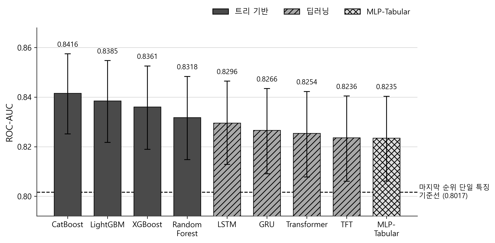

# YouTube 트렌딩 지속성 조기 예측

**한국어** | [English](README.en.md)

**Early Prediction of YouTube Trending Persistence**

트렌딩에 진입한 영상의 초기 관측만으로 **트렌딩에 오래 머무를 영상**을 예측하는 연구입니다. KCI 등재 논문과 관련된 코드·실험 결과를 공개하며, 초기 K개 스냅샷에서 추출한 특징으로 트리 기반 모델과 시계열 딥러닝 모델을 비교합니다.

[논문 정보](https://www.kci.go.kr/kciportal/ci/sereArticleSearch/ciSereArtiView.kci?sereArticleSearchBean.artiId=ART003397844) · [대표 결과](#대표-결과) · [주요 코드](#주요-코드) · [실행 안내](docs/DATA_AND_ENVIRONMENT.md) · [인용](#인용)

## 관련 논문

### 초기 스냅샷 기반 유튜브 트렌딩 지속성 조기 예측

*Early Prediction of YouTube Trending Persistence from Initial Snapshots*

**이훈제**, 박영아, 박준, 정세훈, 심춘보 
스마트미디어저널 (*Smart Media Journal*), **15(10), 172–184**, 2026년 10월

논문 초록에서 데이터 규모와 CatBoost(K=14)의 **ROC-AUC 0.8416 · AP 0.6294 · F1 0.6270**을 확인했으며, 저장된 v3 집계값과 일치합니다. [KCI 공식 기록](https://www.kci.go.kr/kciportal/ci/sereArticleSearch/ciSereArtiView.kci?sereArticleSearchBean.artiId=ART003397844) · [논문과 코드 안내](docs/PAPER.md)

| 분석 대상 | 초기 관측 길이 | CatBoost ROC-AUC |
|:---:|:---:|:---:|
| **한국 트렌딩 영상 17,883개** | **K = 5 · 7 · 10 · 14** | **0.8416** |

## 연구 과제

- **입력:** 영상별 초기 K개 트렌딩 스냅샷과 정적·변화량 특징
- **목표:** 전체 트렌딩 등장 횟수가 **60회 이상**인 장기 지속 영상 분류
- **기준:** 60회는 전체 영상의 등장 횟수 분포에서 75백분위수이며, 양성 영상은 **4,575개**입니다.
- **비교:** Random Forest, XGBoost, LightGBM, CatBoost, MLP와 LSTM, GRU, Transformer, TFT 계열 모델

트렌딩 진입 여부나 모든 YouTube 영상의 인기도를 예측하는 과제가 아닙니다. K=14 실험에는 초기 관측 조건을 만족한 **17,410개 영상**을 사용하며, 주 실험의 학습·검증·시험 비율은 **70/15/15**입니다.

## 대표 결과

아래는 보관된 **v3 실험 결과의 K=14 시험 성능**입니다. F1은 검증 데이터에서 선택한 임곗값을 시험 데이터에 적용한 값입니다.

| 모델 | ROC-AUC | AP | F1 |
|:---|---:|---:|---:|
| **CatBoost** | **0.8416** | 0.6294 | 0.6270 |
| LightGBM | 0.8385 | **0.6353** | 0.6272 |
| XGBoost | 0.8361 | 0.6286 | **0.6284** |
| Random Forest | 0.8318 | 0.6150 | 0.6226 |
| LSTM | 0.8296 | 0.5940 | 0.6236 |
| GRU | 0.8266 | 0.5853 | 0.6261 |
| Transformer | 0.8254 | 0.5769 | 0.6198 |
| TFT | 0.8236 | 0.5838 | 0.6219 |
| MLP-Tabular | 0.8235 | 0.5758 | 0.6215 |

CatBoost의 ROC-AUC 95% bootstrap 신뢰구간은 **[0.8252, 0.8575]**입니다. AP는 LightGBM, F1은 XGBoost가 가장 높습니다. [ML 결과 CSV](results/tables/tab6_ml_v3.csv) · [DL 결과 CSV](results/tables/tab6_dl_v3.csv)

초기 관측 길이 K에 따른 비교

K별 대상 영상 수가 달라, 동일한 표본에서 관측 길이만 바꾼 비교로 해석하지 않습니다. [ML 집계](results/tables/tab7_ml_kabl_v3.csv) · [DL 집계](results/tables/tab8_dl_kabl_v3.csv)

수치는 저장된 CSV와 일치하도록 정리했으며, 공개 과정에서 학습·평가를 다시 실행하지 않았습니다. 이전 원고에 남아 있는 수치와의 차이, 표본 구성, 전처리 및 추가 실험의 해석 범위는 [결과 안내](docs/RESULTS.md)에 기록했습니다.

## 주요 코드

| 목적 | 파일 |
|:---|:---|
| 원본 CSV 전처리와 영상별 라벨 생성 | [2_preprocess.py](scripts/preprocessing/2_preprocess.py) |
| 초기 K개 관측의 시퀀스와 데이터 분할 구성 | [4_make_sequence.py](scripts/preprocessing/4_make_sequence.py) |
| 머신러닝·딥러닝 실험 | [3_run_ml_v2.py](scripts/training/3_run_ml_v2.py) · [5_run_dl.py](scripts/training/5_run_dl.py) |
| v3 머신러닝 집계와 평가 | [ml_tables_v3.py](scripts/evaluation/ml_tables_v3.py) · [eval_v3_main.py](scripts/evaluation/eval_v3_main.py) |
| 딥러닝 평가 | [eval_dl_v3.py](scripts/evaluation/eval_dl_v3.py) |
| 저장된 v3 수치의 시각화 | [9_paper_figures_v3.py](scripts/visualization/9_paper_figures_v3.py) |

실험은 여러 시기에 작성된 분기로 구성됩니다. 파일 번호 전체가 하나의 최종 실행 순서를 뜻하지는 않습니다. 분기별 역할과 공개 사본의 경로 변경은 [코드 안내](docs/CODE_MAP.md)에 정리했습니다.

기술: **Python · pandas · scikit-learn · PyTorch · XGBoost · LightGBM · CatBoost · Matplotlib**

## 구성과 실행

~~~text
scripts/
  preprocessing/   데이터 전처리·시퀀스 생성
  training/        모델 학습·하이브리드 실험
  evaluation/      모델 비교·예측·평가
  analysis/        특성·관측 길이·임곗값 분석
  visualization/   결과 그림 생성
  tools/           데이터·특성 점검
  legacy/          초기 ML·DL 실험
results/           선별한 집계표와 대표 그림
docs/              논문·코드·환경·결과 안내
requirements.txt   직접 의존성
CITATION.*         논문 인용 정보
~~~

이 저장소는 연구 코드 아카이브입니다. **저장소 루트에서** `python scripts/preprocessing/2_preprocess.py`와 같이 실행합니다. 필요한 데이터·전처리 배열·모델은 별도로 준비해야 합니다. [코드 폴더 안내](scripts/README.md) · [데이터와 환경 안내](docs/DATA_AND_ENVIRONMENT.md)

원본 데이터, 영상별 예측값, 모델 가중치, 논문 원고와 심사 대응 자료는 로컬 연구 아카이브에 보관합니다. 기존 가상환경의 설치 정보도 기록했으며, 실행 환경은 새로 구성합니다. 공개본에는 코드·설명·선별한 집계 결과를 포함했습니다.

## 인용

> 이훈제, 박영아, 박준, 정세훈, 심춘보. (2026). 초기 스냅샷 기반 유튜브 트렌딩 지속성 조기 예측. *스마트미디어저널*, 15(10), 172–184.

[BibTeX](CITATION.bib) · [CITATION.cff](CITATION.cff) · [KCI 논문 정보](https://www.kci.go.kr/kciportal/ci/sereArticleSearch/ciSereArtiView.kci?sereArticleSearchBean.artiId=ART003397844)
