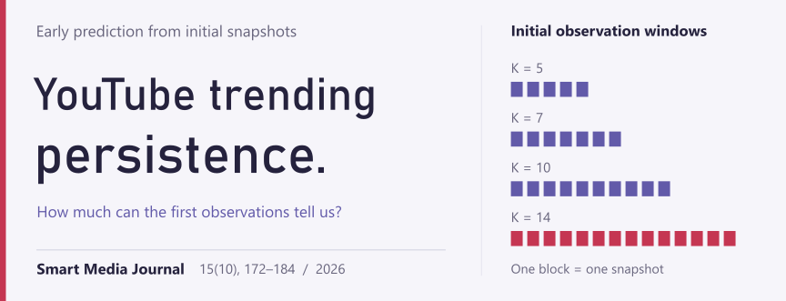
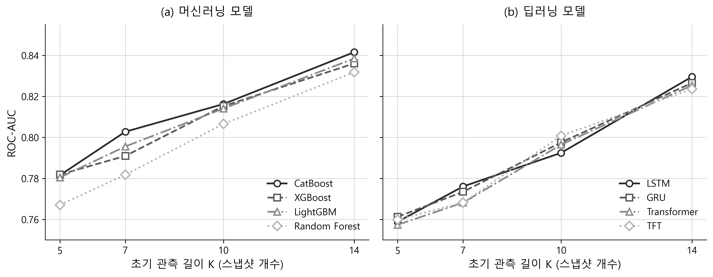

**English** · [한국어](README.ko.md)



Which videos will stay on the trending list longer? This research uses a video's **first K trending snapshots** to predict long persistence, comparing tree-based and sequence models on Korean YouTube trending data.

**[Read the paper record](https://www.kci.go.kr/kciportal/ci/sereArticleSearch/ciSereArtiView.kci?sereArticleSearchBean.artiId=ART003397844)** &nbsp; · &nbsp; **[View results](#results)** &nbsp; · &nbsp; **[Explore code](#explore-the-code)**

## The prediction task

**17,883 Korean trending videos** · **872,060 observations** · **K = 5, 7, 10, 14**

- **Observe:** the first K trending snapshots, with static and change-related features.
- **Predict:** whether a video appears in **at least 60 distinct trending snapshots** overall.
- **Compare:** nine models, from Random Forest and CatBoost to LSTM, GRU, Transformer, and a TFT-style model.

The study starts with videos already observed in trending. The target is persistence within that list; total appearance counts include the initial K observations. The threshold of 60 is the full population's 75th percentile, with **4,575 positive videos**.

## Results

The main **K=14** experiment uses **17,410 eligible videos** and a stratified random **70/15/15** train/validation/test split.


**CatBoost has the highest ROC-AUC point estimate (0.8416).** LightGBM has the highest **AP (0.6353)**, while XGBoost has the highest **F1 (0.6284)**. F1 uses a threshold selected on validation data and applied to the test set.

The chart is drawn directly from the archived [ML](results/tables/tab6_ml_v3.csv) and [DL](results/tables/tab6_dl_v3.csv) aggregates. Confidence intervals show uncertainty; the ranking alone does not establish significant differences between models.

<details>
<summary>Full evaluation table</summary>

| Model | ROC-AUC | AP | F1 |
|:---|---:|---:|---:|
| **CatBoost** | **0.8416** | 0.6294 | 0.6270 |
| LightGBM | 0.8385 | **0.6353** | 0.6272 |
| XGBoost | 0.8361 | 0.6286 | **0.6284** |
| Random Forest | 0.8318 | 0.6150 | 0.6226 |
| LSTM | 0.8296 | 0.5940 | 0.6236 |
| GRU | 0.8266 | 0.5853 | 0.6261 |
| Transformer | 0.8254 | 0.5769 | 0.6198 |
| TFT | 0.8236 | 0.5838 | 0.6219 |
| MLP-Tabular | 0.8235 | 0.5758 | 0.6215 |

CatBoost's saved ROC-AUC 95% bootstrap interval is **[0.8252, 0.8575]**. The CSV tables include intervals for all nine models. [Original archived comparison figure](results/figures/fig1_model_comparison.png)

</details>

<details>
<summary>How results vary with the number of early snapshots</summary>



The eligible populations are **17,743 / 17,677 / 17,569 / 17,410 videos** for K=5 / 7 / 10 / 14. Because the cohorts differ, this comparison does not isolate observation length on an identical set of videos.

[ML aggregates](results/tables/tab7_ml_kabl_v3.csv) · [DL aggregates](results/tables/tab8_dl_kabl_v3.csv)

</details>

Training and evaluation were not rerun for this release. The KCI abstract confirms the dataset size and CatBoost's headline results; the full archived comparison has not been checked against the published paper's body. [Result provenance and interpretation](docs/RESULTS.md) (Korean)

## Publication

**Early Prediction of YouTube Trending Persistence from Initial Snapshots**

**이훈제**, 박영아, 박준, 정세훈, 심춘보<br>
*Smart Media Journal* · **15(10), 172–184** · October 2026 · KCI indexed

The official abstract reports CatBoost at K=14 with **ROC-AUC 0.8416, AP 0.6294, and F1 0.6270**, matching the saved v3 aggregates. Author names follow the official KCI record.

[KCI paper record](https://www.kci.go.kr/kciportal/ci/sereArticleSearch/ciSereArtiView.kci?sereArticleSearchBean.artiId=ART003397844) · [Paper and code notes](docs/PAPER.md) · [BibTeX](CITATION.bib)

## Explore the code

| Focus | Entry points |
|:---|:---|
| Prepare data and early-observation sequences | [Preprocessing](scripts/preprocessing/2_preprocess.py) · [Sequence construction](scripts/preprocessing/4_make_sequence.py) |
| Inspect model training experiments | [Machine learning](scripts/training/3_run_ml_v2.py) · [Deep learning](scripts/training/5_run_dl.py) |
| Inspect v3 evaluation and result tables | [ML tables](scripts/evaluation/ml_tables_v3.py) · [ML evaluation](scripts/evaluation/eval_v3_main.py) · [DL evaluation](scripts/evaluation/eval_dl_v3.py) |

**[All 51 research scripts](scripts/README.md)** · **[Code map](docs/CODE_MAP.md)** · **[Archived figure script](scripts/visualization/9_paper_figures_v3.py)**

Python · pandas · scikit-learn · PyTorch · XGBoost · LightGBM · CatBoost · Matplotlib

<details>
<summary>Repository map</summary>

```text
scripts/
  preprocessing/   Data preparation and sequence construction
  training/        Model training and hybrid experiments
  evaluation/      Model comparison, predictions, and evaluation
  analysis/        Feature, observation-length, and threshold studies
  visualization/   Result plotting
  tools/           Data and feature checks
  legacy/          Earlier ML and DL experiments
results/
  tables/          Selected archived aggregate results
  figures/         Original archived comparison figures
docs/              Paper, code, environment, and result notes
  assets/          README cover and CSV-based comparison chart
requirements.txt   Direct dependencies
CITATION.*         Paper citation metadata
```

</details>

<details>
<summary>Running experiments and accessing data</summary>

This repository is a research code archive. Run scripts **from the repository root**, for example `python scripts/preprocessing/2_preprocess.py`, after preparing the required data, processed arrays, and model files. Create a fresh environment using the [data and environment guide](docs/DATA_AND_ENVIRONMENT.md), which includes an English summary.

The code contains several historical experiment branches. Running every numbered script in order is not a single final reproduction pipeline. See the [code map](docs/CODE_MAP.md) for branch roles and portability changes to the public copies.

Raw data, per-video predictions, model weights, manuscripts, and review correspondence remain in the local research archive. The public repository contains code, documentation, and selected aggregate results.

Supporting guides are primarily in Korean. [Result limitations](docs/RESULTS.md) cover cohort definitions, threshold changes, feature importance, and additional temporal-split experiments.

</details>

## Citation

> 이훈제, 박영아, 박준, 정세훈, 심춘보. (2026). Early Prediction of YouTube Trending Persistence from Initial Snapshots. *Smart Media Journal*, 15(10), 172–184.

[BibTeX](CITATION.bib) · [CITATION.cff](CITATION.cff) · [Official paper record](https://www.kci.go.kr/kciportal/ci/sereArticleSearch/ciSereArtiView.kci?sereArticleSearchBean.artiId=ART003397844)
